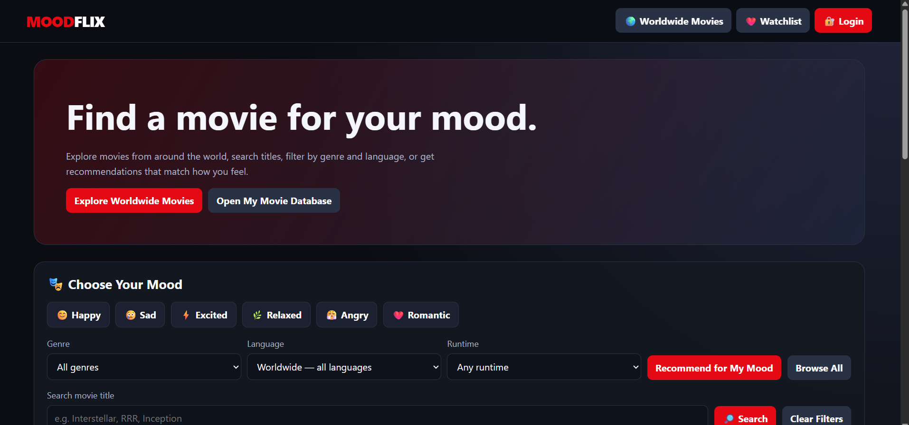

# 🎬 MoodFlix — Mood-Based Movie Recommendation System

MoodFlix is a web-based movie recommendation application built using **Java, Spring Boot, and MySQL**. It helps users discover movies, explore movie information, and manage their watchlists.

## ✨ Features

* 🎭 Mood-based movie discovery
* 🎬 Movie browsing and information
* 👤 User registration and login
* 📋 Watchlist management
* 🛠️ Admin interface
* 🎞️ TMDB movie data integration
* 🗄️ MySQL database integration
* 🌐 Web-based user interface

## 🛠️ Technologies Used

* **Backend:** Java, Spring Boot
* **Database:** MySQL
* **Database Access:** Spring Data JPA
* **Frontend:** HTML, CSS, JavaScript
* **Build Tool:** Maven
* **Movie Data:** TMDB API
* **Version Control:** Git and GitHub

## 🚀 Getting Started

### Prerequisites

Install the following before running the project:

* Java JDK compatible with the project's `pom.xml`
* MySQL Server
* Git

### 1. Clone the repository

```bash
git clone https://github.com/vishnuv9391/MoodFlix.git
cd MoodFlix
```

### 2. Create the database

Open MySQL and execute:

```sql
CREATE DATABASE moodflix;
```

### 3. Configure the application

Configure your database connection and TMDB API credentials using environment variables or local configuration.

Do not publish database passwords or private API tokens in the repository.

### 4. Run the application

On Windows PowerShell:

```powershell
.\mvnw.cmd spring-boot:run
```

On macOS or Linux:

```bash
chmod +x mvnw
./mvnw spring-boot:run
```

### 5. Open MoodFlix

Once the application starts, visit:

http://localhost:8080

The URL may differ if your application uses a different port or route.

## 📸 Screenshots

Add screenshots of the running application here.

### Home Page



### Login Page


### Watchlist


*Add the corresponding image files to a `screenshots` folder for these images to display.*

## 📁 Project Structure

```text
MoodFlix/
├── .mvn/
├── src/
│   ├── main/
│   │   ├── java/com/moodflix/
│   │   │   ├── config/
│   │   │   ├── controller/
│   │   │   ├── model/
│   │   │   ├── repository/
│   │   │   └── service/
│   │   └── resources/
│   │       └── static/
│   └── test/
├── .gitignore
├── mvnw
├── mvnw.cmd
├── pom.xml
└── README.md
```

## 🧪 Run Tests

```powershell
.\mvnw.cmd test
```

## 🔐 Security

* Keep database credentials and API tokens private.
* Use environment variables for sensitive configuration.
* Protect authentication and administrative functionality before production deployment.

## 🔮 Future Enhancements

* Personalized movie recommendations
* Advanced mood and genre filters
* Movie ratings and reviews
* Responsive mobile interface
* Cloud deployment

## 👨‍💻 Author

**Vishnu**

* GitHub: [@vishnuv9391](https://github.com/vishnuv9391)
* Repository: [MoodFlix](https://github.com/vishnuv9391/MoodFlix)

## 📄 License

No license has been specified yet.

---

⭐ If you like this project, consider starring the repository!
